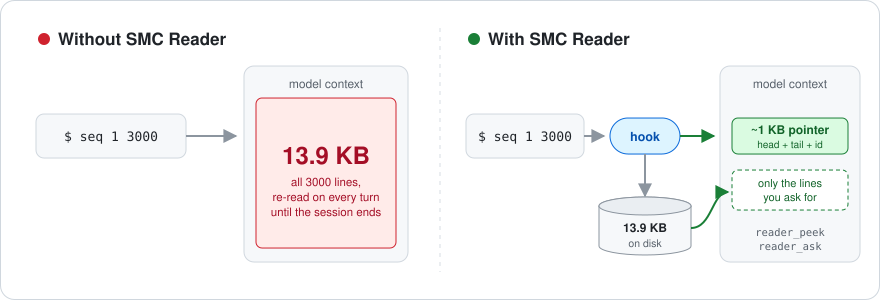
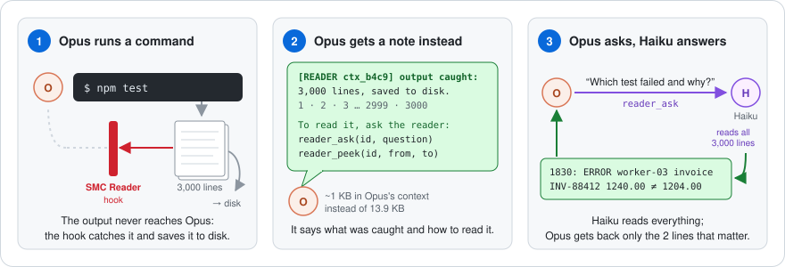

<div align="center">

# SMC Reader

**Save My Context Reader** — keep large tool outputs out of your agent's context window.

[](https://github.com/bulatko/SMCReader/actions/workflows/ci.yml)
[](LICENSE)




</div>

A big `Bash` or `WebFetch` output does not have to land in the model's context.
SMC Reader's hook catches it **before the model sees it**, spills it to disk and hands the model a
short pointer. The model then pulls only what it needs — exact lines, or an answer to a question.

## Quick start

```sh
git clone https://github.com/bulatko/SMCReader ~/smcreader
cd ~/smcreader && npm install --omit=dev
claude --plugin-dir ~/smcreader
```

That's it — no `settings.json` or `--mcp-config` edits. Run something noisy and the model gets this
instead of 3000 lines:

```
[READER ctx_b4c9b23c] Bash output intercepted: 13893 bytes, 3001 lines (>2048 chars).
1
2
...
... (2989 lines omitted — in the reader) ...
2999
3000
Full output is in reader ctx_b4c9b23c: mcp__plugin_smcreader_smcreader__reader_ask(id, question) to analyze, mcp__plugin_smcreader_smcreader__reader_peek(id, start_line, end_line) for exact lines, mcp__plugin_smcreader_smcreader__reader_close(id) when done.
```

## Why

Agents run commands whose output is mostly noise for the task at hand: test logs, build output,
`grep -r`, `git log`, fetched pages. Every byte of it stays in the context for the rest of the
session, pushes out what matters and makes every following turn more expensive.
Truncating is not a fix — the one line the agent needs may be in the middle.

Measured on our own agent transcripts over 5 days (19–23 Oct 2026): **472 interceptions, 2.88 MB**
of tool output.

| what the agent did with the intercepted output | share |
|---|---:|
| nothing — the head and tail in the pointer were enough | **48%** |
| asked a question (`reader_ask`) | 11% |
| pulled a part of it (`reader_peek`) | 14% |
| pulled almost everything back | 27% |

**54% of the intercepted bytes (1.55 MB) never entered the context.** On outputs of 16 KB and more
the saving is about **21 KB per interception**.

## How it works

<p align="center">

</p>

The main model (Opus, Fable) runs a command as usual — but the output never reaches it. SMC Reader's
hook catches it on the way, saves it to disk and gives the model a short note instead: what was caught
and how to read it. When the model needs something, it asks a cheap model (Haiku) with `reader_ask`;
Haiku reads the whole output and returns only the lines that answer the question, verbatim.
Exact lines by number (`reader_peek`) come straight from disk, with no model at all.

Under the hood:

1. Claude Code runs a tool and passes the result to the `PostToolUse` command hook.
2. If the output is large (≥ 2048 chars by default), the hook writes it to
   `~/.cache/smcreader/ctx_<id>.txt` and replaces it with a pointer **in the same shape as the
   original output** — the engine silently ignores a replacement of a different shape.
3. The model sees the pointer: id, size, head and tail of the output.
4. It pulls what it needs through the `smcreader` MCP server:

| tool | what it does |
|---|---|
| `reader_peek(id, start_line, end_line)` | exact numbered lines from disk, no LLM |
| `reader_ask(id, question)` | a small Haiku session reads the document and returns the relevant lines verbatim with a short note |
| `reader_open({path \| text, briefing})` | open any file or text explicitly |
| `reader_list()` / `reader_close(id)` | what is open / delete a document |

The hook and the MCP server are separate processes sharing one directory; the directory is the
source of truth (open-document limit, LRU eviction, 48 h expiry since last use).

## Install

**As a plugin (recommended)** — see [Quick start](#quick-start). The repository is also a plugin
marketplace, so you can install it permanently:

```
/plugin marketplace add bulatko/SMCReader
/plugin install smcreader@smcreader
```

The plugin's MCP server needs its npm dependencies in the plugin directory
(`npm install --omit=dev`); the hook itself has none. Loaded as a plugin, the tools are named
`mcp__plugin_smcreader_smcreader__reader_*`, and the hook writes these names into the pointer.

<details>
<summary><b>Manual setup</b> (hook in <code>settings.json</code> + <code>claude mcp add</code>)</summary>

```sh
npm install -g smcreader        # or: git clone … && npm install --omit=dev
```

1. Hook — add to `~/.claude/settings.json` (or a project's `.claude/settings.json`):

```json
{
  "hooks": {
    "PostToolUse": [
      { "matcher": "Bash|WebFetch",
        "hooks": [{ "type": "command", "command": "READER_TOOL_PREFIX=mcp__smcreader__ smcreader-hook" }] }
    ]
  }
}
```

2. MCP server:

```sh
claude mcp add smcreader -- smcreader-mcp
```

With a git checkout instead of a global install use `node /ABSOLUTE/PATH/bin/smcreader-hook` and
`node /ABSOLUTE/PATH/bin/smcreader-mcp`. The old binary names `reader-hook` / `reader-mcp` remain
as aliases.

Both processes read the same environment; if you set `READER_DIR`, set it for both
(`claude mcp add smcreader -e READER_DIR=/path -- smcreader-mcp`).

**Intercepting an MCP tool.** Add it to the hook's `matcher` **and** to `READER_ALLOWLIST`, e.g.
matcher `Bash|WebFetch|mcp__mesh__execute` and command
`READER_ALLOWLIST=Bash,WebFetch,mcp__mesh__execute smcreader-hook`. Never allowlist SMC Reader's
own tools.

**Read guard (optional).** `PreToolUse`, matcher `Read`, same command with
`READER_READ_GUARD=32768`: a full `Read` of a file above the threshold is denied with working
alternatives (`Read` with offset/limit, Grep, `reader_open`, sed/head/tail). The plugin does not
enable it.

</details>

<details>
<summary><b>Configuration</b> (environment variables)</summary>

| variable | default | used by | meaning |
|---|---|---|---|
| `READER_DIR` | `$XDG_CACHE_HOME/smcreader` or `~/.cache/smcreader` | both | shared document directory |
| `READER_THRESHOLD` | `2048` | hook | intercept outputs of at least this many characters |
| `READER_ALLOWLIST` | `Bash,WebFetch` | hook | comma-separated tool names to intercept |
| `READER_TOOL_PREFIX` | — | hook | tool-name prefix written into the pointer, e.g. `mcp__smcreader__` |
| `READER_READ_GUARD` | `0` (off) | hook | bytes; deny a full `Read` of bigger files (`PreToolUse`) |
| `READER_LOG` | — | hook | append a log line per interception / error to this file |
| `READER_OWNER` | — | server (hook: fallback) | owner the server acts as; unset = sees all documents |
| `READER_ASK_FORMAT` | `lines` | server | default `reader_ask` format: `lines` (verbatim lines + short note) or `prose` |
| `READER_WORK_DIR` | `$TMPDIR/reader-work` | server | cwd of the Haiku reader sessions (their transcripts land there) |

**Owners.** The hook stamps each document with the `session_id` from its input (a subagent's
document gets `<session>/agent:<agent_id>`). The open-document limit (10) and LRU eviction are per
owner; `reader_close` refuses another owner's document when the server has `READER_OWNER`;
reading by id is never restricted.

</details>

<details>
<summary><b>Development</b> (layout, tests)</summary>

| path | role |
|---|---|
| `lib/reader-store.js` | document store over a directory (`ctx_<8hex>.txt` + `.meta.json`), owners, LRU limit, TTL sweep |
| `lib/reader-model.js` | Haiku reader via Agent SDK `query()`; answer formats `prose` / `lines`; `createRunQuery({cwd, settings, cleanupPeriodDays})` for embedding hosts |
| `lib/reader-tools.js` | transport-free tool definitions `reader_open/ask/peek/close/list` |
| `lib/intercept-hook.js` | interception: extract text, mirror the tool's output shape, build the pointer |
| `lib/read-guard.js` | optional `PreToolUse` guard for big `Read`s |
| `lib/stdio-mcp.js`, `bin/smcreader-mcp` | stdio MCP server (`@modelcontextprotocol/sdk`) |
| `lib/reader-mcp.js` | in-process MCP factory for the Agent SDK (`createSdkMcpServer`) — same tools |
| `lib/hook-command.js`, `bin/smcreader-hook` | the command hook (stdin JSON → stdout JSON) |
| `.claude-plugin/`, `hooks/hooks.json`, `.mcp.json` | Claude Code plugin + marketplace manifests |
| `e2e/claude-code.sh`, `e2e/plugin.sh` | end-to-end tests in a real Claude Code CLI |

```sh
npm test                                         # unit + cross-process (spawns the real bin/ scripts)
sh e2e/claude-code.sh                            # real Claude Code: hook via --settings, server via --mcp-config
READER_E2E_NO_HOOK=1 sh e2e/claude-code.sh       # negative control: no hook — must fail
sh e2e/plugin.sh                                 # real Claude Code, everything from --plugin-dir
READER_E2E_NO_PLUGIN=1 sh e2e/plugin.sh          # negative control: no --plugin-dir — must fail
```

The e2e verdict comes from `--output-format stream-json`, i.e. from what the model actually
received, not from what it said: (1) the Bash `tool_result` contains `[READER ctx_` and not
`1500` (from `seq 1 3000`); (2) a reader tool call with that id returned `2999`. One run takes
~10–20 s and ~$0.03 on Haiku. CI runs only `npm test`: e2e needs a logged-in Claude Code.

</details>

## Limitations

- Needs a Claude Code version that applies `hookSpecificOutput.updatedToolOutput` from command
  hooks (verified on 2.1.282). Older versions call the hook but keep the original output.
- Supported output shapes: string, `{stdout,…}` (Bash), `{content:[…]}` (MCP), `{output}`,
  `{file:{content}}` (Read), arrays of content blocks. Unknown shape → passed through untouched.
- `Read` is not intercepted by default — `Edit` needs exact bytes. Use the read guard instead.
- `reader_ask` needs Claude Code credentials (Agent SDK, model Haiku). Documents above 700 KB can
  only be peeked; above 5 MB `reader_open` refuses them.
- The plugin's hook sets an environment variable inline (`VAR=… node …`), which needs a POSIX
  shell; Windows is not tested.
- The server does not know the Claude Code session by itself (it outlives `/clear` and resumes);
  set `READER_OWNER` if you need per-session isolation in a shared `READER_DIR`.

## License

MIT — see [LICENSE](LICENSE).
